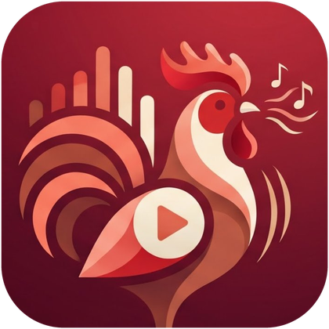

<p align="center">
  
</p>

<h1 align="center">Reproductor</h1>

<p align="center">
  Un reproductor de música y multimedia para Android: ligero, bonito y sin anuncios.<br>
  <b>Sin publicidad · Sin rastreadores · Sin permiso de Internet · 100 % offline</b>
</p>

---

## ¿Qué es?

**Reproductor** es una app Android nativa (Kotlin + Jetpack Compose) que reproduce la música, los videos y los GIF que ya tienes en tu teléfono. Su identidad visual sale de su mascota, el gallo con auriculares: turquesa y cian de fondo, rojo gallo para los botones principales y naranja y amarillo para los detalles.

> Versión 1.0.0. Primera versión pública: el código compila y se genera el APK automáticamente, pero se está probando en dispositivos reales. Si encuentras un fallo, abre un *issue*.

## Funciones

### 🎵 Reproducción
- Reproducir, pausar, anterior y siguiente.
- Barra de progreso interactiva y control de volumen.
- Aleatorio y tres modos de repetición: ninguna, toda la lista o la canción actual.
- Portada del álbum, título, artista, álbum y duración.
- **Cola de reproducción editable**: reordena arrastrando, quita canciones, añade "a continuación" o al final.
- Formatos habituales: MP3, AAC/M4A, FLAC, OGG, WAV, Opus y más (motor ExoPlayer / Media3).

### 📚 Biblioteca
- Escanea la música del dispositivo y se actualiza sola cuando añades archivos.
- Navega por **canciones, artistas, álbumes, carpetas, géneros** (si hay metadatos) y **añadidas recientemente**.
- **Búsqueda** por título, artista, álbum, género o nombre de archivo, ignorando acentos.
- "Quitar de la biblioteca" solo oculta la canción en la app: **nunca borra el archivo**. Se puede restaurar desde Ajustes.

### 📋 Playlists
- Crear, renombrar y eliminar playlists.
- Añadir y quitar canciones, y **reordenarlas arrastrando**.
- Se conservan al cerrar la app o reiniciar el teléfono.

### 🎬 Video y GIF
- Reproductor de video integrado: reproducir/pausar, avanzar/retroceder, barra de progreso y volumen.
- Visor de **GIF animados**.
- Si un video o GIF tiene el mismo nombre que una canción, se ofrece al reproducirla.

### 🎤 Letras
- Lee archivos **.lrc** (sincronizados línea a línea, con salto al tocar una línea) y **.txt**.
- Funciona sin Internet: busca junto a la canción (Android 10 o anterior) o en la carpeta de letras que elijas en Ajustes (Android 11 o superior).
- Si no hay letra, lo indica sin más.

### 🔔 Segundo plano
- Sigue sonando al minimizar la app, cambiar de aplicación o apagar la pantalla.
- Controles en la **notificación** y en la **pantalla de bloqueo**, y compatibilidad con botones de auriculares y Bluetooth.
- Se pausa solo si desconectas los auriculares.

### 🎨 Interfaz
- Diseño minimalista con formas redondeadas y animaciones suaves.
- **Modo claro, oscuro o según el sistema.**
- Mini reproductor persistente mientras navegas.
- Pantallas: Inicio, Biblioteca, Playlists, Reproductor, Búsqueda y Ajustes.

## Privacidad
- No declara el permiso de Internet: **la app no puede conectarse a ninguna red**.
- Sin anuncios, sin SDK publicitarios, sin analíticas ni rastreadores.
- Solo pide acceso a música, videos e imágenes (para encontrar tus archivos) y notificaciones (para los controles).

## Instalación
1. Ve a **Releases** y descarga el último `app-release.apk`.
2. Ábrelo en el teléfono y permite "instalar apps desconocidas" cuando Android lo pida.
3. Al iniciar, concede el permiso para leer tus archivos multimedia.

Requiere **Android 8.0 (API 26)** o superior.

## Compilar desde el código
La forma más fácil: sube el repositorio a GitHub y descarga el APK desde **Actions** (el flujo de trabajo ya está incluido).

En local, con JDK 17 y el Android SDK:
```bash
gradle wrapper --gradle-version 8.9
./gradlew assembleRelease
```
El APK queda en `app/build/outputs/apk/release/`. También puedes abrir la carpeta con Android Studio y usar *Build → Build APK(s)*.

## Tecnologías
Kotlin · Jetpack Compose · Material 3 · AndroidX Media3 (ExoPlayer y MediaSession) · Room · DataStore · Coil · Navigation Compose.

## Estructura
```
app/src/main/java/com/reproductor/app/
  data/       MediaStore, Room, DataStore, letras y portadas
  domain/     Lector de archivos LRC
  playback/   Servicio de reproducción y controlador
  ui/         Tema, navegación, pantallas y componentes
```

## Limitaciones conocidas
- No lee letras incrustadas en las etiquetas de los archivos, solo `.lrc` y `.txt`.
- En Android 11 o superior las letras requieren elegir una carpeta una vez.
- La portada de la notificación puede no aparecer con algunos archivos.
- El APK release se firma con la clave de depuración. Para publicarlo en Google Play, hay que firmarlo con tu propia clave.
